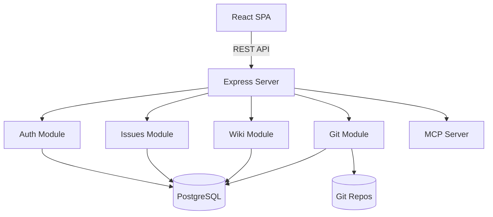

# Architecture Overview

Axiom is a modular monolith combining project management, Git hosting, and documentation.

## System Diagram

## Key Design Decisions

### Modular Monolith
Each domain module has its own routes, controller, and service layer. Shared database access via Prisma.

### Authentication
- JWT access tokens (15 min expiry)
- HTTP-only refresh tokens (7 day expiry)
- Optional 2FA with TOTP

### Git Hosting
- Bare repositories stored on disk at `/data/repos/{org}/{team}/{slug}.git`
- Custom Git Smart HTTP backend for push/pull
- Post-receive hooks for commit-to-issue linking

### Frontend
- React 19 with React Router v7
- TanStack Query for server state
- Zustand for client state
- Tailwind CSS with CSS variable design tokens
- All icons from lucide-react (no emojis)

## Database Schema

Key relationships:
- **Organization** has many **Teams**
- **Team** has many **Projects**, **Repositories**, and **WikiSpaces**
- **Project** has many **Issues** organized into **BoardColumns**
- **Repository** has many **PullRequests** with **Reviews** and **Comments**
