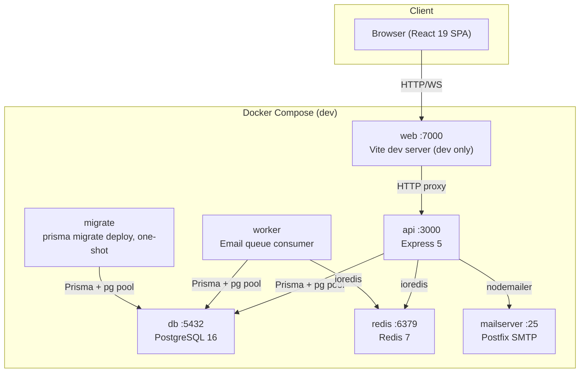
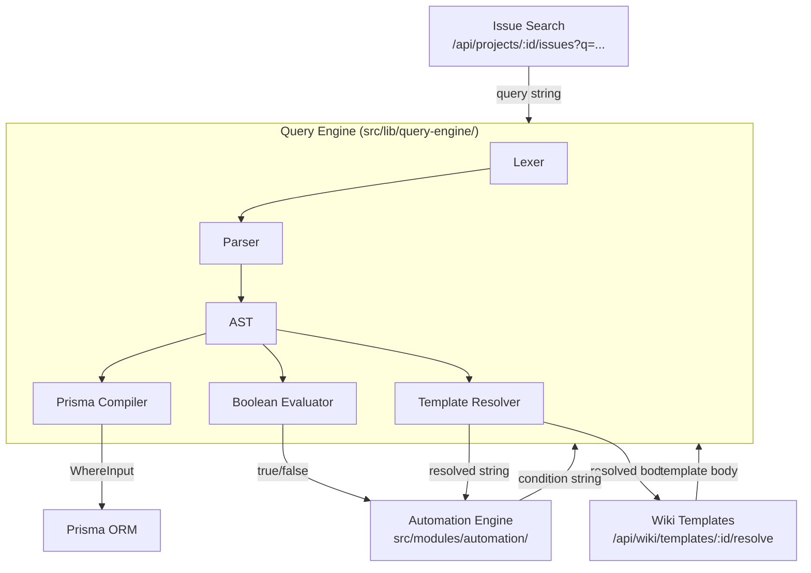
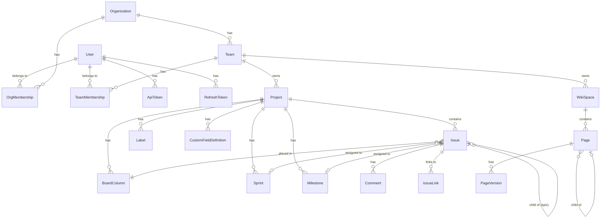
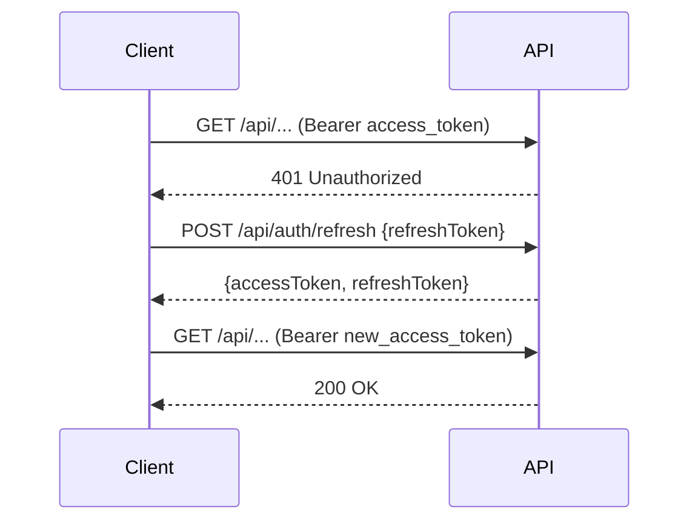
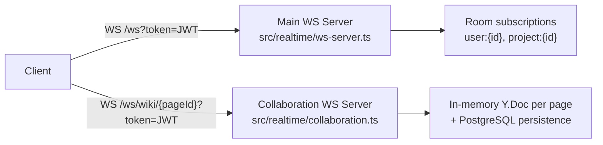

# Axiom Architecture

## Table of Contents

1. [System Overview](#system-overview)
2. [Backend Architecture](#backend-architecture)
3. [Shared Libraries](#shared-libraries)
4. [Database Schema](#database-schema)
5. [Authentication and Authorization](#authentication-and-authorization)
6. [Real-time Architecture](#real-time-architecture)
7. [Frontend Architecture](#frontend-architecture)
8. [Caching Strategy](#caching-strategy)
9. [File Storage](#file-storage)
10. [Email](#email)
11. [Error Handling](#error-handling)
12. [Security Model](#security-model)
13. [Development Infrastructure](#development-infrastructure)

---

## System Overview

Axiom is a self-hosted Jira and Confluence replacement built for agents: issue tracking, sprints and boards, a collaborative wiki, and an MCP server so agents can work in the same projects you do. A GitHub integration links one repository per project for the code side. It is built as a monorepo with a Node.js/Express API backend and a React single-page application frontend.

**Key versions:**
- Node.js 25
- Express 5.2
- Prisma 7.5 (with `@prisma/adapter-pg` driver adapter)
- PostgreSQL 16
- Redis 7
- React 19.2
- Vite 8.0
- React Router 7.13
- TanStack Query 5.95
- Zustand 5.0
- TipTap 3.20 (editor)
- Yjs 13.6 (CRDT collaboration)



### Containers

One image, one codebase. Each container runs a different entry point. Production has no separate web container: Express serves the built frontend (`STATIC_DIR`, default `public`), so the `web` node in the diagram above exists only in development (Vite with HMR).

| Service | Entry point | Volumes | Ports | Role |
|---|---|---|---|---|
| `migrate` | `node dist/migrate.js` (one-shot) | none | Runs `prisma migrate deploy`. Exits 0. |
| `api` | `node dist/index.js` | `uploads` | `${PORT:-7000}:3000` | REST, WebSocket, MCP, and the built SPA (served from `/app/public`). |
| `worker` | `node dist/worker.js` | none | none | Email queue consumer. |
| `db`, `redis` | images | `pgdata`, `redis_data` | internal | `redis` requires `REDIS_PASSWORD`. |

`api` and `worker` each declare `depends_on: migrate: condition: service_completed_successfully`, so migrations finish before either of them starts.

---

## Backend Architecture

### Entry Point

`src/index.ts` creates the Express app, registers all middleware and routes, attaches the WebSocket server, and starts the HTTP server. The server only listens when run directly (not when imported by tests).

### Middleware Pipeline

Requests pass through the following middleware in order:

1. `helmet` — sets security-related HTTP headers
2. `cors` — allows configured origins with credentials
3. `requestLogger` — structured request logging (pino) with a request id; served frontend paths are skipped
4. `metricsCollector` — records method, path, status and duration for `/api/health/metrics`
5. `signedUploadRouter` — `PUT /api/uploads/:uploadId`, whose signature is its credential; it sits ahead of the JSON parser, the CSRF guard and `require2fa`, with its own limiter
6. `express.json({ limit: '5mb' })` — JSON body parsing
7. `nulGuard` — refuses NUL in the path, query or JSON body of an `/api` request (`/api/mcp`, `/api/act` and `/api/read` check it per action)
8. `requestContextMiddleware` — opens the per-request context that `authenticate` fills in
9. `globalLimiter` — 300 requests/minute per IP on `/api` (skipped in test env)
10. `authLimiter` — 15 requests/minute on `/api/auth/login`, `/api/auth/refresh`, `/api/auth/register`, `/api/auth/forgot-password`, `/api/auth/reset-password`; `searchLimiter` — 30 requests/minute on `/api/search`
11. `csrfGuard` — applied to all `/api/*` routes (see [Security Model](#security-model))
12. `openApiRouter` — `/api/docs` and `/api/openapi.json`, public
13. `require2fa` — 2FA enforcement for signed-in sessions
14. `auditMiddleware` — registers a `finish` listener to log mutating API requests to `AuditLog`
15. The action routes (`mountActions`), then `/api/act` and `/api/mcp`
16. A catch-all `authenticate` for `/api`, then a JSON `404`: a stranger gets `401` on any unknown path, a signed-in caller or token gets `404`
17. The built frontend, when `NODE_ENV` is production or `STATIC_DIR` is set
18. `errorHandler` — global error handler (must be last)

### Module System

All feature code lives under `src/modules/`. Each module follows the pattern:

```
src/modules/<feature>/
  <feature>.actions.ts    # defineAction: input, output, authorize, REST binding, handler
  <feature>.service.ts    # Business logic — interacts with Prisma
```

There are no route or controller files. An action's `rest` binding gives it a path, and the REST adapter mounts it. A handler calls a service. Services never touch `req`/`res` and throw `AppError` on failure.

**Registered modules (route prefix → module):**

| Prefix | Module |
|--------|--------|
| `/api/auth` | auth |
| `/api/users` | users |
| `/api/orgs` | orgs |
| `/api/teams` | teams |
| `/api/projects` | projects, issues, activity, sprints, custom-fields, workflows, automation, labels, issue-templates, milestones |
| `/api/wiki` | wiki |
| `/api/search` | search |
| `/api/attachments` | attachments |
| `/api/notifications` | notifications |
| `/api/saved-filters` | saved-filters |
| `/api/admin` | admin, audit |
| `/api/act`, `/api/read` | The action registry by name, and read by key |
| `/api/mcp` | Model Context Protocol, Streamable HTTP, API tokens only |
| `/api/docs`, `/api/openapi.json` | API documentation generated from the registry |

### Action registry

Each operation is one `defineAction` with a name, an area and kind (`read` or `write`), a Zod input and output, an optional REST binding, `authorize` and a `handler` that calls a service. `executeAction` runs: unknown, `uiOnly`, raw, scope, parse `target` (the ids authorize needs), `authorize`, parse the full input, handler, then one audit row per write. Three adapters share it:

- **REST.** `mountActions` mounts every action's binding under `/api/*`. Every route is an action: no router, controller or path rule stands beside the registry. A binding can also be `public` (no authentication, for public forms and health), carry its own `rateLimit`, or be `raw` when the handler answers through `ctx.http` (uploads, downloads, exports).
- **`/api/act` and `/api/read`.** An action by name, or a batch, and read by key.
- **MCP.** The five tools of `src/mcp/agent-tools.ts`, authenticated by API token so each write carries its token's name as `via`.

#### What a token reaches

The registry alone decides, from the definition of each action:

- **Area and kind.** A token needs `<area>:read` or `<area>:write`. `openToReadOf` lets a read scope on any of several areas stand in for it on the caller's own state (profile, notifications, dashboard). Registry rule R18 limits it to reads and to writes that belong to no org and do no harm.
- **`uiOnly`.** Login and the like: refused to tokens and to `act`.
- **`tokenBlocked`.** Normal for a browser session, refused to every token (invite links, changing your profile).
- **`admin`.** Orgs, teams, members, tokens, space permissions, page restrictions and project writes. A token's call always waits for approval.
- **`destructive`, `destructiveWhen`, `permissionChange`.** Deletes and removals wait by default, an org may relax them. `destructiveWhen` makes an action destructive for some inputs only (renaming a board column). `permissionChange` waits whatever any rule says.

A public action is declared with `definePublicAction`, whose context has no `userId`, so a handler that reads it doesn't compile. `src/actions/token-reach.json` freezes which scopes reach which action and must change in the same commit as any reach change, which `registry-rules.test.ts` checks; `token-reach.test.ts` calls every action with a token of each scope and checks the answer. `no-legacy.test.ts` walks the Express router and fails on any `/api` route that is no binding. It also lists the function middleware that `app.use` mounts on `/api` paths and compares it with a named list, so a handler added with `app.use` fails it until it is named there.

OpenAPI and `describe` are generated from the same definitions, so documentation can't drift from behavior. `src/actions/parity.test.ts` and `registry-rules.test.ts` fail when a route, an input type or a scope rule drifts.

### Supporting Infrastructure

- `src/realtime/` — WebSocket server, Yjs collaboration
- `src/storage/` — File storage abstraction
- `src/email/` — BullMQ-backed email queue (started only when `SMTP_HOST` is set)
- `src/actions/` — The action registry: `defineAction`, `registerActions`, `executeAction`, the REST adapter, `act` batches, keys and `item.read`. Modules declare their actions in `*.actions.ts`
- `src/mcp/` — The MCP server: five tools (`search`, `read`, `describe`, `act`, `upload`) over the registry, stateless Streamable HTTP
- `src/modules/github/`: The GitHub integration: one client module (`github-client.ts`, which checks every host it calls), the App set up through GitHub's manifest flow, the webhook and its delivery log, and users' connected accounts. Auth resolvers (`github-resolvers.ts`) and webhook handlers (`webhook-handlers.ts`) are imported by both `index.ts` and `worker.ts`
- `src/lib/secret-box.ts`, `src/lib/secret-migration.ts`, Encryption of stored secrets and re-encryption on key rotation
- `src/lib/openapi/` — OpenAPI and the `/api/docs` page, generated from the registry
- `src/lib/` — Shared cross-cutting libraries (query engine, etc.)
- `src/utils/` — Logger, Pandoc export, param helpers, validation
- `src/config/` — `database.ts` (Prisma), `redis.ts` (ioredis), `env.ts` (typed env vars)

---

## Shared Libraries

### Query Engine (`src/lib/query-engine/`)

The query engine is a reusable text-query compiler used by issue search, automation conditions, and wiki template resolution. It exposes a single structured pipeline:

```
Query string
    │
    ▼
Lexer  (tokenises field:value, operators, quoted strings, parentheses)
    │
    ▼
Parser  (recursive-descent, builds AST nodes: AND / OR / NOT / Comparison / FullText)
    │
    ▼
AST
    │
    ├──► Prisma Compiler  (AST → Prisma WhereInput, used by issue search)
    │
    ├──► Boolean Evaluator  (AST → evaluates against a hydrated object, used by automation conditions)
    │
    └──► Template Resolver  (resolves {{expression}} placeholders in action strings / wiki templates)
```

**Two compiler backends:**

| Backend | Input | Output | Used by |
|---------|-------|--------|---------|
| Prisma compiler | Query AST | `Prisma.IssueWhereInput` | Issue list / search endpoint |
| Boolean evaluator | Query AST + issue object | `true` / `false` | Automation condition matching |

**Field registry:** Each backend registers a set of known field names and their type mappings. Adding support for a new filterable field means registering it in the field registry — the lexer, parser, and AST are unaffected.

**Template expression resolver:** Handles `{{expression}}` substitution in automation action values and wiki page templates. Expressions are evaluated against a typed context object and may reference context properties or built-in functions.



### Automation Architecture

Automation rules are stored as `AutomationRule` records and evaluated at trigger sites throughout the codebase. The automation module lives in `src/modules/automation/`.

**Condition format:** Rule conditions are stored as query strings in `AutomationRule.condition` (e.g., `status:open AND priority:high`). These strings are compiled by the query engine's boolean evaluator against a hydrated issue object at trigger time. The legacy `AutomationRule.conditions` JSON field is retained for backward-compatibility migration only.

**Trigger sites:** Automation is triggered from issue mutation services (create, update, status change, assignment, label change). Each trigger site:
1. Fetches a fully hydrated issue using the `AUTOMATION_ISSUE_INCLUDE` constant (ensures all relation fields needed by condition evaluation are present)
2. Evaluates each active rule's condition string against the issue object
3. For matching rules, executes each action in order
4. Passes a `skipAutomation` flag on internal mutations to prevent infinite loops

**Action types:**

| Action type | Description |
|-------------|-------------|
| `set_status` | Change issue status to a named column |
| `set_assignee` | Assign or unassign the issue |
| `add_label` | Add a label by name |
| `add_comment` | Post a comment (body supports `{{...}}` templates) |
| `set_field` | Set an allowlisted content field or a custom field (`custom:<name>`) |
| `create_issue` | Create a linked child issue |
| `send_email` | Send an email to a specified address |
| `webhook` | POST a JSON payload to an external URL (SSRF-protected) |

**Template expressions in actions:** Action field values support `{{expression}}` syntax resolved via the template resolver. At execution time the resolver receives an `AutomationTemplateContext` containing the triggering issue and actor.

**GitHub triggers:** `src/modules/github/github-automation.ts` fires eight triggers (`pr:opened`, `pr:merged`, `pr:closed`, `pr:review_requested`, `pr:review_submitted`, `checks:failed`, `checks:passed`, `branch:created`) after the webhook handlers and the reconcile have stored an event. Only an issue whose key is in the branch name or the PR title is a target; bodies and commits are never read. The context reaches the rule as `github.*` (`github-template.ts`): text is escaped where it renders as Markdown and is plain, single-line and cut elsewhere.

**Noise limits:** a `GithubAutomationMark` row claims one comment per trigger, PR or branch, head commit and issue, and rows older than 90 days are cleaned up. A comment is allowed only for an event at or after the link time; an older event can still move a ticket, so the first sync after linking moves tickets without commenting. Email, webhook and create_issue actions follow the same age rule as comments (`outboundGuard`); only the comment has the per-head slot. The sender gets no notification. A rule acts as the mapped Axiom user when that user is a member of the project's org, else as the built-in GitHub user. Mentions are never read from code, link addresses or bare URLs, and an escaped `\@` is literal.

**Default rules:** when a project links a repository, `default-rules.ts` creates up to four ordinary rules through the rule service (two to four, depending on the board's columns): PR opened moves to In review, PR merged moves to done (both with `done = false`), a comment when a PR merges and a comment when checks fail. `GithubRepoLink.defaultRulesCreatedAt` is claimed with one conditional update, so they are made once per link; a deleted rule stays deleted for that link, and linking again creates the missing ones again. `migrate` gives links that predate the feature their rules at the first deploy.

**Realtime from the worker:** automation that runs in the worker writes through the same services, and `broadcastToRoom` hands the event to a publish hook that the Redis bridge sets in worker mode. The bridge allow-list covers the issue, comment and board events automation emits, in project rooms only, so browsers see a rule's change.

**SSRF protection:** The `webhook` action validates the target URL against a blocklist of private IP ranges and loopback addresses before dispatching the request.

### Template Variables

The `{{expression}}` syntax is shared between automation actions and wiki page templates. The template resolver parses content for `{{...}}` blocks and substitutes each expression against the supplied context.

**Context types:**

| Context | Used by | Available as |
|---------|---------|--------------|
| `AutomationTemplateContext` | Automation actions | `issue`, `actor` |
| `WikiTemplateContext` | Wiki template resolution | `currentUser`, `page` |

**Built-in functions available in all contexts:**

| Function | Returns |
|----------|---------|
| `currentUser()` | Display name of the authenticated user |
| `now()` | Current timestamp (ISO 8601) |
| `empty()` | Empty string (useful for clearing fields) |
| `currentSprint()` | Name of the active sprint in the current project |
| `startOfDay()` | Midnight of the current day (ISO 8601) |
| `startOfWeek()` | Midnight of the current Monday (ISO 8601) |

**Wiki template resolution endpoint:** `POST /api/wiki/templates/:id/resolve` accepts a `WikiTemplateContext` payload and returns the template body with all `{{...}}` expressions substituted. This allows the frontend to preview a resolved template before inserting it into a page.

---

## Database Schema

Axiom uses PostgreSQL 16 via Prisma 7 with the `@prisma/adapter-pg` driver adapter (connection pooling via `pg.Pool`). All IDs are CUIDs.

### Entity Relationship Overview



### Schema Groups

**Identity and Auth:** `User`, `ApiToken`, `RefreshToken`, `PasswordResetToken`, `InviteLink`, `Invitation`

**Organizations and Teams:** `Organization`, `OrgMembership` (roles: OWNER/ADMIN/MEMBER/VIEWER/GUEST), `Team`, `TeamMembership` (roles: ADMIN/MEMBER/VIEWER)

**Projects and Issues:** `Project`, `BoardColumn`, `Issue` (types: TASK/BUG/STORY/EPIC; priorities: CRITICAL/HIGH/MEDIUM/LOW), `Label`, `Comment`, `IssueLink` (types: BLOCKS/IS_BLOCKED_BY/RELATES_TO/DUPLICATES), `IssueVote`, `IssueWatcher`, `TimeEntry`

**Planning:** `Sprint`, `Milestone`, `CustomFieldDefinition`, `CustomFieldValue`, `WorkflowRule`, `AutomationRule` (`condition String?` — query string format; `conditions Json?` — deprecated, kept for migration), `SavedFilter`

**Wiki:** `WikiSpace`, `Page`, `PageVersion`, `PageComment`, `PageLabel`, `PageTemplate`

**Platform:** `Notification`, `NotificationPreference`, `Attachment`, `Activity`, `AuditLog`

---

## Authentication and Authorization

### Authentication Methods

Axiom supports two authentication methods, all resolved in `src/middleware/auth.ts`:

**1. JWT Bearer tokens (browser sessions)**
- Short-lived access tokens signed with `JWT_SECRET`
- `Authorization: Bearer eyJ...`
- Payload: `{ userId: string }`
- Auto-refresh: the frontend API client intercepts 401 responses, calls `POST /api/auth/refresh`, and retries the original request. Concurrent 401s share a single refresh promise to avoid token races.

**2. API tokens (programmatic)**
- Long-lived tokens with the prefix `tk_`, stored as SHA-256 hashes in the `api_tokens` table
- `Authorization: Token tk_...`
- Support optional expiry and scopes (e.g., `["issues:read", "issues:write"]`)

### JWT Refresh Flow



Refresh tokens are stored as SHA-256 hashes in the `refresh_tokens` table with an expiry date. On logout, the token record is deleted from the database. If refresh fails, `localStorage` is cleared and the user is redirected to `/login`.

### Two-Factor Authentication (TOTP)

Users can enable TOTP 2FA. The TOTP secret is stored on the `User` record (`twoFactorSecret`). When `twoFactorEnabled` is true, the login endpoint returns an error with `code: 'TWO_FACTOR_REQUIRED'` and the client must re-submit with a `twoFactorCode`. The `otplib` library handles TOTP generation and verification. The secret is stored encrypted (see [Secrets and Credentials](#secrets-and-credentials)).

### Authorization (RBAC)

RBAC is enforced at the route level via middleware in `src/middleware/rbac.ts` and `src/middleware/requireProjectAccess.ts`. The permission model has two levels:

**Org-level roles:** OWNER > ADMIN > MEMBER > VIEWER > GUEST

**Team-level roles:** ADMIN > MEMBER > VIEWER

Org-level admins and owners bypass team-level checks — they have implicit permission on all teams in their org. The `requireTeamPermission(action)` middleware checks team membership first, then falls back to the org role.

The `hasPermission(orgRole, teamRole, action)` and `hasOrgPermission(orgRole, action)` utilities in `src/utils/permissions.ts` define the permission matrix.

Platform admins (`User.isAdmin = true`) bypass all RBAC checks.

---

## Real-time Architecture

Axiom uses two WebSocket servers attached to the same HTTP server instance, routed during the HTTP upgrade event by URL path.



### Main WebSocket Server (`/ws`)

- Authenticates via JWT from `?token=` query param or `Authorization: Bearer` header
- Each connection maintains a `Set<string>` of subscribed room names
- On connect, auto-subscribes to `user:{userId}`
- Clients send `{ type: 'subscribe', rooms: [...] }` and `{ type: 'unsubscribe', rooms: [...] }` messages
- Server broadcasts `RealtimeEvent` payloads to all clients subscribed to a matching room
- Heartbeat: pings every 30 seconds, terminates connections that do not respond with a pong

**Event types:**

| Event type | Triggered by | Room |
|------------|-------------|------|
| `issue:updated` | Issue mutation | `project:{projectId}` |
| `issue:created` | New issue | `project:{projectId}` |
| `comment:added` | New comment | `project:{projectId}` |
| `board:moved` | Column change | `project:{projectId}` |
| `issue:links-updated` | Wiki page linked to or unlinked from an issue | `issue:{issueId}` |
| `issue:development-updated` | GitHub branches, pull requests or commits of some issues changed (`issueIds`) | `project:{projectId}` |
| `wiki:updated` | Page save | `wiki:{spaceId}` |
| `notification` | Any notification | `user:{userId}` |

The frontend hook `useRealtimeInvalidation` subscribes to relevant rooms and calls `queryClient.invalidateQueries()` on matching events, keeping TanStack Query caches fresh without polling.

### Collaboration WebSocket Server (`/ws/wiki/{pageId}`)

Implements the Yjs sync protocol for real-time collaborative wiki editing:

- One `Y.Doc` per wiki page, keyed by `pageId`, stored in a server-side `Map<string, CollabRoom>`
- `y-protocols/sync` (ESM-only, dynamically imported and cached) handles CRDT merge via the three-message handshake: sync step 1 (server sends state vector) → sync step 2 (client sends missing updates) → subsequent updates broadcast to all peers
- `y-protocols/awareness` propagates cursor positions and user presence; each client's display name is fetched from the database on connect
- On connect: server sends sync step 1 and current awareness state to the new client
- Document updates are debounce-persisted to PostgreSQL via `scheduleSave`; on the last client disconnect, `forceSave` is called immediately
- Rooms are destroyed and memory freed when the last client disconnects
- Two application messages sit beside the Yjs ones. Type `20` carries the external-change state of the page (a pending change, or that it was merged and by whom), and type `21` carries the merge lock. Types 0 and 1 stay sync and awareness. `y-websocket` reserves 0–3, which is why these start at 20.

### Markdown as the source of truth for wiki pages

`Page.body` and `PageVersion.body` only ever contain Markdown, never Yjs state or editor XML. The Yjs document of a room is a working copy: it is built from `Page.body` when the room opens, and converted back to Markdown whenever it is saved.

The conversion lives in one shared editor core, `frontend/src/editor-core/`: the TipTap schema and the Markdown rules. The browser imports it directly. The backend gets it as a CommonJS bundle (`dist-editor-core/editor-core.cjs`, built by `npm run build:editor-core`) through `src/lib/editor-core.ts`, so both sides read and write the same structure. The same core holds the block-level three-way merge.

Every write that does not come from an editor session goes through `writePageBody` (`src/modules/wiki/page-writes.ts`). It stores the new body at once and records a version. If a collaboration room is live for the page, the write is also recorded in `PendingPageChange`, together with the body it replaced, and the room is told with a type `20` message. The open editor shows a notice, and the person editing merges per block (`page-merge.ts`) or, for overlapping blocks, in a side-by-side conflict view. Applying the merge writes a `MERGE` version and replaces the room content. Before that, the session's own text is saved as a `SESSION_DRAFT` version, so neither side is lost.

---

## Frontend Architecture

### Technology Stack

| Concern | Library | Version |
|---------|---------|---------|
| UI framework | React | 19.2 |
| Build tool | Vite | 8.0 |
| Routing | React Router | 7.13 |
| Server state | TanStack Query | 5.95 |
| Client state | Zustand | 5.0 |
| Editor | TipTap | 3.20 |
| CRDT | Yjs | 13.6 |
| Icons | lucide-react | 1.7 |
| CSS | Tailwind CSS | 4.x |
| TypeScript | 5.8 | |

### Directory Structure

```
frontend/src/
  App.tsx               # Root component: auth loading, route tree
  api/                  # API client + per-module API helpers
    client.ts           # fetch wrapper with auto token refresh
  components/
    layout/             # AppShell, Sidebar, Header, Breadcrumbs
    ui/                 # Shared components (Button, Modal, Input, etc.)
    editor/             # MarkdownRenderer, MarkdownEditor (TipTap)
  pages/                # Route components (lazy-loaded)
  routes/               # Route group definitions (project-routes, admin-routes)
  stores/               # Zustand stores
  hooks/                # Custom hooks
  lib/                  # Types, utils, guards
```

### Routing

React Router v7 is used throughout. All imports come from `'react-router'` (not `'react-router-dom'`). Routes are organized into groups:

- **Guest routes** (`GuestGuard`): `/login`, `/register`, `/forgot-password`, `/reset-password/:token`
- **Authenticated routes** (`AuthGuard` + `AppShell`):
  - `/` — Dashboard
  - `/:org` — Team list for org
  - `/:org/:team` — Team detail
  - `/:org/:team/:project/*` — Project routes (issues, board, backlog, sprints, wiki, settings)
  - `/admin/*` — Platform admin routes

All page components are lazy-loaded with `React.lazy` and wrapped in `<Suspense fallback={<PageLoader />}>` and `<ErrorBoundary>`.

### State Management

**Server state** is managed entirely by TanStack Query. Query keys follow the resource hierarchy (e.g., `['issue', projectId, issueNumber]`). Mutations invalidate related queries — for example, updating an issue invalidates `['issue']`, `['board']`, and `['issues']`.

**Client state** uses two Zustand stores:

- `useAuthStore` — `user`, `isAuthenticated`, `isLoading`; actions: `login`, `logout`, `register`, `loadUser`
- `useUIStore` — sidebar state, command palette visibility, keyboard shortcut help panel state

On app load, `App.tsx` calls `loadUser()`. If an access token exists in `localStorage`, it fetches `GET /api/users/me` to rehydrate the user; otherwise it sets `isAuthenticated: false` immediately.

### API Client

`frontend/src/api/client.ts` provides `get`, `post`, `patch`, `del` helpers built on `fetch`. Every request automatically:
- Attaches `Authorization: Bearer {accessToken}`
- Attaches `X-Requested-With: XMLHttpRequest` (CSRF header required by the server)
- On 401: triggers a shared `refreshPromise` (deduplicating concurrent refreshes), then retries the original request once
- On refresh failure: clears `localStorage` and redirects to `/login`

Tokens are stored in `localStorage` (both access and refresh). An in-module variable `accessToken` caches the value to avoid repeated `localStorage.getItem` calls.

Binary downloads (e.g., Pandoc wiki exports) use raw `fetch` with a manual `Authorization` header rather than the `api()` helper, as they require a `Blob` response rather than JSON.

---

## Caching Strategy

Redis 7 is used via `ioredis` for server-side caching. The client is configured in `src/config/redis.ts` with lazy connect and a retry strategy that gives up after 3 attempts. If Redis is unavailable, the application logs a warning and continues without caching (graceful degradation — `connected` flag gates all cache reads/writes).

Cache operations are centralized through `cacheGet(key)` and `cacheSet(key, value, ttl)` helpers exposed from `src/config/redis.ts`. The default TTL is 60 seconds. `cacheInvalidate(key)` is called from service mutations to bust stale entries.

On the frontend, TanStack Query provides client-side caching of all server state with configurable `staleTime` and `gcTime` per query. The `useRealtimeInvalidation` hook bridges WebSocket events to query invalidation, ensuring the cache stays fresh without polling.

---

## File Storage

File uploads are handled by the `attachments` module using `multer` for multipart parsing. The storage layer is abstracted behind a `StorageBackend` interface in `src/storage/storage.ts`:

```typescript
interface StorageBackend {
  put(key: string, data: Buffer, contentType: string): Promise<void>;
  get(key: string): Promise<Buffer>;
  delete(key: string): Promise<void>;
  exists(key: string): Promise<boolean>;
}
```

The default (and currently only) backend is `LocalStorageBackend` (`src/storage/local.ts`), which writes files to `STORAGE_PATH` on disk (default `.data/uploads`, bind-mounted in dev). The backend is a lazy singleton returned by `getStorage()`.

Storage keys follow the pattern `attachments/{year}/{month}/{cuid}.{ext}`. The `Attachment` database record links a storage key to its uploader and to one of: an issue, a wiki page, or a comment.

`attachments.service.ts` also uses Pandoc (via `execFile`) to convert certain uploaded document formats (DOCX, ODT, EPUB, HTML, CSV, RST, LaTeX, Org) at download time.

---

## Email

Outbound email is sent via `nodemailer` through a configurable SMTP server (`SMTP_HOST`, `SMTP_PORT`, `SMTP_FROM`). In the dev Docker stack, a Postfix-based `docker-mailserver` container handles local delivery.

Email sending is backed by a BullMQ queue (`src/email/queue.ts`) using Redis as the broker. The email worker is started only when `SMTP_HOST` is set in the environment, allowing the API to operate without email in environments that do not need it.

---

## Error Handling

### Backend

Services throw `new AppError(statusCode, message, code?)`. The global error handler in `src/middleware/errorHandler.ts` is registered as the last middleware and handles three cases:

- `AppError` — responds with `{ error: { message, code } }` at the specified HTTP status code
- `ZodError` — responds with `400 { error: { message: 'Validation failed', code: 'VALIDATION_ERROR', details: issues[] } }`
- All other errors — logged via `logger.error`, responds with `500 { error: { message: 'Internal server error', code: 'INTERNAL_ERROR' } }`

All error responses share the shape `{ error: { message: string, code?: string } }`.

### Frontend

- `ErrorBoundary` components wrap all lazy-loaded route components to catch React render errors
- `ApiError` (thrown by the API client) carries `status`, `message`, and optional `code`
- The `useToast` hook (`toast.success()`, `toast.error()`, `toast.info()`) surfaces transient errors and confirmations to the user
- Unrecoverable auth failures (refresh token expired) redirect to `/login` via `window.location.href`

---

## Security Model

### CSRF Protection

`csrfGuard` middleware is applied to all `/api/*` routes. It rejects state-changing requests (`POST`, `PUT`, `PATCH`, `DELETE`) that do not include `X-Requested-With: XMLHttpRequest`. This custom header cannot be sent cross-origin without a CORS preflight, blocking simple cross-site form submission attacks against the JWT/`localStorage` auth scheme. The API client sets this header automatically on every request.

### Rate Limiting

`express-rate-limit` enforces these limits per IP (all disabled in the test environment):

| Limiter | Routes | Window | Limit |
|---------|--------|--------|-------|
| Global | All `/api` routes | 60 s | 300 requests |
| Auth | `/api/auth/login`, `/api/auth/refresh`, `/api/auth/register`, `/api/auth/forgot-password`, `/api/auth/reset-password` | 60 s | 15 requests |
| Search | `/api/search` | 60 s | 30 requests |
| Public forms | public form submissions and secret checks | 60 s | 20 requests |
| Signed uploads | `PUT /api/uploads/:uploadId` | 60 s | 30 requests |

Standard `RateLimit-*` response headers are sent by every limiter. Only the global limiter disables the legacy `X-RateLimit-*` headers; the others send those as well.

### RBAC

There is no guard middleware on routes. Every route is an action's binding, and each action authorizes itself before its input is fully validated: its `authorize` function (built from the helpers in `src/actions/authorize.ts`) runs after `authenticate` has set `req.userId`. The helpers call the checks in `src/middleware/rbac.ts` and `src/middleware/requireProjectAccess.ts`:

- `assertOrgPermission` / `checkOrgMember` — `OrgMembership.role` against the permission matrix
- `checkTeamPermission` / `checkTeamRead` — `TeamMembership.role` with org-level fallback
- `checkWikiSpaceOrgAccess`, `assertPageAccess`, `assertPageAccessBySlug`, `assertCommentAccess`, `assertTemplateAccess`, `assertRestrictionAccess` — org membership, space permissions and page restrictions for wiki resources
- `checkProjectAccess` / `checkProjectAction` — project membership and the role a project write needs

### HTTP Security Headers

`helmet` is applied globally and sets headers including `Content-Security-Policy`, `X-Content-Type-Options`, `X-Frame-Options`, and `Strict-Transport-Security`.

### Secrets and Credentials

- `JWT_SECRET` and `JWT_REFRESH_SECRET` must each be at least 32 characters
- API token raw values are never stored; only their SHA-256 hashes are persisted in `api_tokens`
- Refresh tokens are stored as SHA-256 hashes with an expiry timestamp in `refresh_tokens`
- `AXIOM_ENCRYPTION_KEY` (base64, 32 bytes) seals the secrets Axiom has to read back: 2FA secrets, the GitHub App's private key, client secret and webhook secret, and connected GitHub tokens. The format is AES-256-GCM, `enc:v1:<kid>:<iv>:<tag>:<ciphertext>`, with the key id and the row context (`secretContext(<model>, <field>, <row id>)`) bound as additional data, so a value only opens in the column and row it was sealed for. `AXIOM_ENCRYPTION_KEY_PREVIOUS` is optional and only for rotation, and `npm run secrets:rotate` re-encrypts the stored values. Losing the key means the encrypted values can't be read. Back it up apart from the database ([Deployment](deployment.md#encryption-key-backup-and-rotation))

### GitHub integration

The GitHub client in `src/modules/github/` is the only code that calls GitHub. It accepts only the configured API and web hosts, never follows a redirect to another host, and logs paths without query strings. Credentials are chosen by auth kind (`app`, `installation`, `user`, `oauth-app`), each served by a resolver. Tests run against a recorded fake server in `src/test/github-fake.ts`, never against github.com.

- **App:** an admin creates it from `/admin/github` through GitHub's manifest flow. The private key, client secret and webhook secret are stored encrypted. Installations are kept in `GithubInstallation` and updated by webhooks and a manual sync. The App writes to GitHub only for the link comment on an imported issue; everything else is written as the user. An integration user named "GitHub" stands for GitHub authors that map to nobody in Axiom.
- **Webhook path:** `POST /api/github/webhook` is mounted before the body parser, behind a rate limiter and a gate that checks the method, the signature headers and the App, and then reads the raw body. The HMAC is checked on the raw bytes. Each delivery is stored in `GithubDelivery` (unique on the delivery id) and processed after the `202`. A claim with a 5 minute lease stops two workers taking one row. Failures retry with backoff up to 5 times; the worker retries due rows every minute and cleans up old payloads.
- **Connected accounts:** each user connects from `/settings/github`. Access and refresh tokens are stored encrypted. A token that expires within 5 minutes is refreshed under a Postgres advisory lock per user, because GitHub's refresh tokens are single use. Disconnecting revokes the grant at GitHub. A refresh GitHub refuses deletes the connection and the refused call answers `409 GITHUB_RECONNECT`; the next one answers `409 GITHUB_NOT_CONNECTED`. A stored secret that the configured key cannot open answers `409 GITHUB_SECRET_UNREADABLE`. GitHub's ids are stored as `BigInt` and appear in JSON as numbers (a string only above 2^53 - 1).

**Repo links and reads.** A project links to one repository (`GithubRepoLink`). Linking needs team ADMIN, a connected account with admin rights on the repository, and an installed App. Deliveries flow in one direction:

1. A webhook is stored, acknowledged, and handled by the worker or the API (`webhook-handlers.ts` imports every handler for both processes).
2. The handler finds issue keys in the branch name, pull request title and body, or commit message, and writes the branch, pull request, review, commit or check run tables. Ordering rules decide what a write may change: an older payload never overwrites newer state, and MERGED is final. A failing step's log tail is downloaded once (100 lines, 16 KB), except that a forbidden or unavailable log is fetched again after an hour.
3. Reads (`development` and `checks` includes, the Development panel) come from those tables only and make no GitHub call. Every change raises an outcome; only branch names and pull request titles decide which issues drive automation.
4. Reconciliation (`reconcile.service.ts`) runs every 15 minutes per link, and on demand with a 1 minute cooldown (the action answers `started` and the run goes on in the background), and skips links whose installation is removed or suspended. It lists open pull requests, check runs and branches within a call budget, under a lease, and feeds the same store functions. `githubRepo.health` reports how it went.

Events from the worker reach browsers through a Redis channel (`axiom:realtime`, `src/realtime/bridge.ts`): the worker publishes, each API process subscribes and broadcasts `issue:development-updated`. The API broadcasts its own events directly, so a browser never hears one twice. With Redis down, worker events are dropped until it returns.

**Issues import.** Opt in per link (`GithubRepoLink.importIssues`, switched by `githubImport.configure`). Three paths feed `importGithubIssue` and `importComment` in `issue-import.service.ts`:

1. The backfill (`import-run.service.ts`): a `GithubImportRun` per link, ticked by the worker every 15 seconds, reading open issues by page (25 new issues a tick) and their comments. It runs no automation rules and sends no notification. A tick holds a lease. Rate limits pause it until GitHub allows more, other errors back off 1, 2, 4 minutes up to 30, and 10 errored ticks in a row, or a day without progress, make it `FAILED`. It publishes `github:import-progress` through the Redis bridge.
2. Live deliveries (`issue-import-events.ts`): `issues` and `issue_comment` events. Each link may take 100 new issues and 300 new comments per clock hour (`import-cap.ts`, one counter row per link and hour, updated conditionally so concurrent deliveries never exceed it). The next delivery after the cap is ignored with its reason, and `githubImport.status` shows the pause. An issue opened after the link time runs `issue:created` rules like any new issue.
3. Reconcile (`reconcile.service.ts`): two cursors on the link (issues and comments), each starting two hours back and never more than 72 hours, read oldest first. A cursor advances per item and stops, without advancing, at the cap or the call budget. A comment pass reads the comments of imported issues whose list was cut short.

Only open issues come in; a pull request, or an issue closed on GitHub, never does. The creator and the commenters map to a member of the project's org, else to the built-in GitHub user with `externalAuthorLogin` set, shown as `GitHub (<login>)`. The writes skip the mention notifier and notify nobody.

Each import row (`GithubIssueImport`, and `GithubImportedComment` for comments) mirrors what the import last wrote: title, body and label set hashes. Update rule: GitHub's value is applied to a field only while Axiom's value is still what the import wrote. Otherwise Axiom's value stays and an `import_conflict` activity names the field. The mirror then follows GitHub, so each later GitHub change is its own conflict. The rows survive the deletion of an Axiom issue or comment and act as tombstones, so a deleted one is never imported again.

The link comment is claimed on the row with a conditional update (`linkCommentClaimedAt`). A claim older than 10 minutes without a stored comment id can be taken over, and the new claimer first looks for the App's comment on the issue and stores that id instead of posting again. Link comments are written as the installation, outside the call budget, and limited to 20 a minute per backfill and 400 an hour per installation, counted across the backfill, live imports and reconcile.

**Release notes.** `writeReleaseNotes` (`release-notes.service.ts`) runs only when someone calls `githubRelease.writeNotes`, as the user's connected account. It checks the tag, compares it with the previous published release, finds the merged pull requests of the compared commits and the tickets they name, and writes one Markdown text twice: to a wiki page in the project's team space, and to the Release body. GitHub text sits in code spans so neither side links or mentions anything. The text starts with `<!-- axiom:release-notes sha256=<hash> -->`, a hash of the text below. A Release body without the marker, or whose hash no longer matches because a person edited it, answers `409` unless `replaceBody` is set; the page is checked for the marker only, as the wiki keeps its versions. A draft Release gets the body and stays a draft. No commits between the tags answers `400 RELEASE_NO_CHANGES` before anything is written, and a compare or pull request list that GitHub cut short sets `truncated`, which the notes state.


---

## Development Infrastructure

The dev stack is defined in `docker-compose.dev.yml` and started with `npm run docker:dev`.

| Service | Image | Port | Purpose |
|---------|-------|------|---------|
| `db` | postgres:16-alpine | 5432 | Primary database |
| `redis` | redis:7-alpine | 6379 | Cache and email queue broker, password `axiom_dev_redis` |
| `mailserver` | docker-mailserver | 25 | Local SMTP for email testing |
| `migrate` | Custom (Dockerfile.dev) | none | Runs `prisma migrate deploy`, then exits (one-shot) |
| `api` | Custom (Dockerfile.dev) | 3000 | Express API with `tsx` watch |
| `worker` | Custom (Dockerfile.dev) | none | Email queue consumer with `tsx` watch |
| `web` | Custom (Dockerfile.dev) | 7000 | Vite dev server |
| `tunnel` | cloudflare/cloudflared | — | Optional Cloudflare tunnel (Docker profile: `tunnel`) |

Source directories are bind-mounted into the containers so that code changes on the host are reflected immediately without rebuilding images.

A test database `axiom_test` is created by `scripts/init-test-db.sql` during PostgreSQL initialization. Integration tests connect to `axiom_test` via a separate `createPrismaClient(url)` call and never touch the `axiom` development database.
