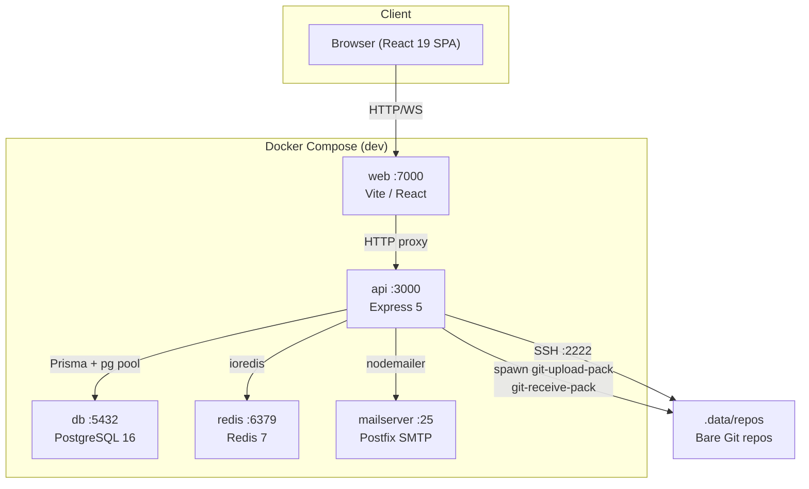
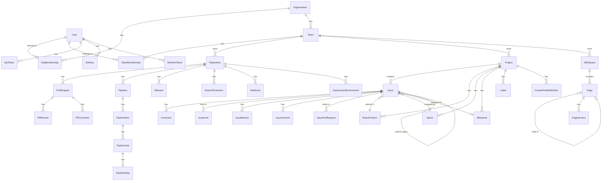
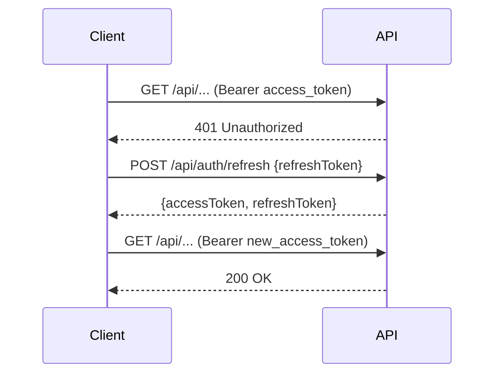
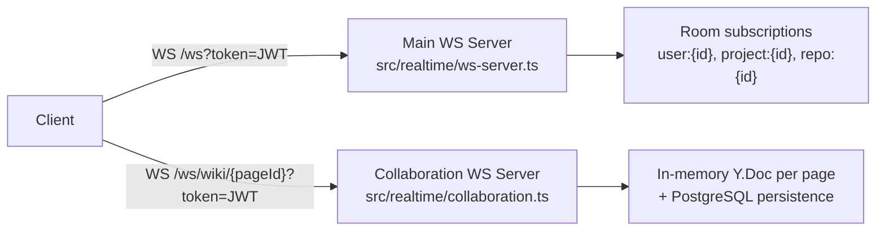

# Axiom Architecture

## Table of Contents

1. [System Overview](#system-overview)
2. [Backend Architecture](#backend-architecture)
3. [Database Schema](#database-schema)
4. [Authentication and Authorization](#authentication-and-authorization)
5. [Real-time Architecture](#real-time-architecture)
6. [Git Hosting Architecture](#git-hosting-architecture)
7. [Frontend Architecture](#frontend-architecture)
8. [Caching Strategy](#caching-strategy)
9. [File Storage](#file-storage)
10. [Email](#email)
11. [Error Handling](#error-handling)
12. [Security Model](#security-model)
13. [Development Infrastructure](#development-infrastructure)

---

## System Overview

Axiom is a self-hosted software development platform providing Git hosting, issue tracking, wiki, CI/CD pipelines, and project management. It is built as a monorepo with a Node.js/Express API backend and a React single-page application frontend.

**Key versions:**
- Node.js 25
- Express 5.2
- Prisma 7.5 (with `@prisma/adapter-pg` driver adapter)
- PostgreSQL 16
- Redis 7
- React 19.2
- Vite 8.0
- React Router 7.13
- TanStack Query 5.95
- Zustand 5.0
- TipTap 3.20 (editor)
- Yjs 13.6 (CRDT collaboration)



---

## Backend Architecture

### Entry Point

`src/index.ts` creates the Express app, registers all middleware and routes, attaches the WebSocket server, and starts the HTTP server. The server only listens when run directly (not when imported by tests).

### Middleware Pipeline

Requests pass through the following middleware in order:

1. `helmet` — sets security-related HTTP headers
2. `cors` — allows configured origins with credentials
3. `morgan` — HTTP request logging (`dev` format in development, `combined` in production)
4. `express.json({ limit: '5mb' })` — JSON body parsing
5. `globalLimiter` — 300 requests/minute per IP (skipped in test env)
6. `authLimiter` — 15 requests/minute on `/api/auth/login`, `/api/auth/refresh`, `/api/auth/register`
7. `csrfGuard` — applied to all `/api/*` routes (see [Security Model](#security-model))
8. `auditMiddleware` — registers a `finish` listener to log mutating API requests to `AuditLog`
9. Route handlers
10. `errorHandler` — global error handler (must be last)

### Module System

All feature code lives under `src/modules/`. Each module follows the pattern:

```
src/modules/<feature>/
  <feature>.routes.ts     # Express Router — mounts at /api/...
  <feature>.controller.ts # Request handlers — delegates to service
  <feature>.service.ts    # Business logic — interacts with Prisma
```

Controllers receive `req`/`res` and call service functions. Services never touch `req`/`res` and throw `AppError` on failure.

**Registered modules (route prefix → module):**

| Prefix | Module |
|--------|--------|
| `/api/auth` | auth |
| `/api/users` | users |
| `/api/orgs` | orgs |
| `/api/teams` | teams |
| `/api/projects` | projects, issues, activity, sprints, custom-fields, workflows, automation, labels, issue-templates, milestones |
| `/api/wiki` | wiki |
| `/api/search` | search |
| `/api/repos` | repos, insights, pulls, protection, webhooks, releases, pipelines, status-checks, code-owners, deployments |
| `/api/attachments` | attachments |
| `/api/notifications` | notifications |
| `/api/saved-filters` | saved-filters |
| `/api/admin` | admin, audit |
| `/api/internal/hooks` | git post-receive hook handler |
| `/git/*` | smart HTTP git protocol |
| `/api/mcp` | Model Context Protocol SSE endpoint (authenticated) |

### Supporting Infrastructure

- `src/git/` — Git protocol, SSH server, bare repo lifecycle
- `src/realtime/` — WebSocket server, Yjs collaboration
- `src/storage/` — File storage abstraction
- `src/email/` — BullMQ-backed email queue (started only when `SMTP_HOST` is set)
- `src/mcp/` — Model Context Protocol server (loaded dynamically to handle missing SDK gracefully)
- `src/utils/` — Logger, Pandoc export, param helpers, validation
- `src/config/` — `database.ts` (Prisma), `redis.ts` (ioredis), `env.ts` (typed env vars)

---

## Database Schema

Axiom uses PostgreSQL 16 via Prisma 7 with the `@prisma/adapter-pg` driver adapter (connection pooling via `pg.Pool`). All IDs are CUIDs.

### Entity Relationship Overview



### Schema Groups

**Identity and Auth:** `User`, `ApiToken`, `SshKey`, `RefreshToken`, `PasswordResetToken`, `InviteLink`, `Invitation`

**Organizations and Teams:** `Organization`, `OrgMembership` (roles: OWNER/ADMIN/MEMBER/VIEWER/GUEST), `Team`, `TeamMembership` (roles: ADMIN/MEMBER/VIEWER)

**Repositories:** `Repository` (visibility: PRIVATE/INTERNAL/PUBLIC), `PullRequest`, `PRReview`, `PRComment`, `Webhook`, `WebhookDelivery`, `BranchProtection`, `CommitStatus`

**Projects and Issues:** `Project`, `BoardColumn`, `Issue` (types: TASK/BUG/STORY/EPIC; priorities: CRITICAL/HIGH/MEDIUM/LOW), `Label`, `Comment`, `IssueLink` (types: BLOCKS/IS_BLOCKED_BY/RELATES_TO/DUPLICATES), `IssueCommit`, `IssuePullRequest`, `IssueBranch`, `IssueVote`, `IssueWatcher`, `TimeEntry`

**Planning:** `Sprint`, `Milestone`, `CustomFieldDefinition`, `CustomFieldValue`, `WorkflowRule`, `AutomationRule`, `SavedFilter`

**Wiki:** `WikiSpace`, `Page`, `PageVersion`, `PageComment`, `PageLabel`, `PageTemplate`

**CI/CD and Deployments:** `Pipeline`, `PipelineRun`, `PipelineJob`, `PipelineStep`, `Release`, `DeploymentEnvironment`, `Deployment`, `EnvironmentVariable`

**Platform:** `Notification`, `NotificationPreference`, `Attachment`, `Activity`, `AuditLog`

---

## Authentication and Authorization

### Authentication Methods

Axiom supports three authentication methods, all resolved in `src/middleware/auth.ts`:

**1. JWT Bearer tokens (browser sessions)**
- Short-lived access tokens signed with `JWT_SECRET`
- `Authorization: Bearer eyJ...`
- Payload: `{ userId: string }`
- Auto-refresh: the frontend API client intercepts 401 responses, calls `POST /api/auth/refresh`, and retries the original request. Concurrent 401s share a single refresh promise to avoid token races.

**2. API tokens (programmatic / git HTTP)**
- Long-lived tokens with the prefix `tk_`, stored as SHA-256 hashes in the `api_tokens` table
- `Authorization: Token tk_...`
- Support optional expiry and scopes (e.g., `["repo:read", "issues:write"]`)
- Git smart HTTP uses HTTP Basic Auth with the API token as the password (username is ignored)

**3. SSH keys (git SSH)**
- Public keys stored with SHA-256 fingerprints in `ssh_keys`
- SSH server authenticates by looking up the fingerprint from the connecting client's public key

### JWT Refresh Flow



Refresh tokens are stored as SHA-256 hashes in the `refresh_tokens` table with an expiry date. On logout, the token record is deleted from the database. If refresh fails, `localStorage` is cleared and the user is redirected to `/login`.

### Two-Factor Authentication (TOTP)

Users can enable TOTP 2FA. The TOTP secret is stored on the `User` record (`twoFactorSecret`). When `twoFactorEnabled` is true, the login endpoint returns an error with `code: 'TWO_FACTOR_REQUIRED'` and the client must re-submit with a `twoFactorCode`. The `otplib` library handles TOTP generation and verification.

### Authorization (RBAC)

RBAC is enforced at the route level via middleware in `src/middleware/rbac.ts` and `src/middleware/requireProjectAccess.ts`. The permission model has two levels:

**Org-level roles:** OWNER > ADMIN > MEMBER > VIEWER > GUEST

**Team-level roles:** ADMIN > MEMBER > VIEWER

Org-level admins and owners bypass team-level checks — they have implicit permission on all teams in their org. The `requireTeamPermission(action)` middleware checks team membership first, then falls back to the org role.

The `hasPermission(orgRole, teamRole, action)` and `hasOrgPermission(orgRole, action)` utilities in `src/utils/permissions.ts` define the permission matrix.

Platform admins (`User.isAdmin = true`) bypass all RBAC checks.

---

## Real-time Architecture

Axiom uses two WebSocket servers attached to the same HTTP server instance, routed during the HTTP upgrade event by URL path.



### Main WebSocket Server (`/ws`)

- Authenticates via JWT from `?token=` query param or `Authorization: Bearer` header
- Each connection maintains a `Set<string>` of subscribed room names
- On connect, auto-subscribes to `user:{userId}`
- Clients send `{ type: 'subscribe', rooms: [...] }` and `{ type: 'unsubscribe', rooms: [...] }` messages
- Server broadcasts `RealtimeEvent` payloads to all clients subscribed to a matching room
- Heartbeat: pings every 30 seconds, terminates connections that do not respond with a pong

**Event types:**

| Event type | Triggered by | Room |
|------------|-------------|------|
| `issue:updated` | Issue mutation | `project:{projectId}` |
| `issue:created` | New issue | `project:{projectId}` |
| `comment:added` | New comment | `project:{projectId}` |
| `board:moved` | Column change | `project:{projectId}` |
| `pr:updated` | PR mutation | `repo:{repoId}` |
| `pr:merged` | PR merge | `repo:{repoId}` |
| `wiki:updated` | Page save | `wiki:{spaceId}` |
| `notification` | Any notification | `user:{userId}` |
| `pipeline:updated` | Pipeline run change | `repo:{repoId}` |

The frontend hook `useRealtimeInvalidation` subscribes to relevant rooms and calls `queryClient.invalidateQueries()` on matching events, keeping TanStack Query caches fresh without polling.

### Collaboration WebSocket Server (`/ws/wiki/{pageId}`)

Implements the Yjs sync protocol for real-time collaborative wiki editing:

- One `Y.Doc` per wiki page, keyed by `pageId`, stored in a server-side `Map<string, CollabRoom>`
- `y-protocols/sync` (ESM-only, dynamically imported and cached) handles CRDT merge via the three-message handshake: sync step 1 (server sends state vector) → sync step 2 (client sends missing updates) → subsequent updates broadcast to all peers
- `y-protocols/awareness` propagates cursor positions and user presence; each client's display name is fetched from the database on connect
- On connect: server sends sync step 1 and current awareness state to the new client
- Document updates are debounce-persisted to PostgreSQL via `scheduleSave`; on the last client disconnect, `forceSave` is called immediately
- Rooms are destroyed and memory freed when the last client disconnects

---

## Git Hosting Architecture

Bare Git repositories are stored at `{REPOS_PATH}/{orgSlug}/{teamSlug}/{repoSlug}.git`. In development, `REPOS_PATH` is `.data/repos` (bind-mounted into the container). In production, it is a Docker named volume at `/data/repos`.

### Smart HTTP (`/git/*`)

Implemented in `src/git/smart-http.ts` and mounted at the Express `/git` prefix.

- **Authentication:** HTTP Basic Auth with an API token (`tk_...`) as the password; username field is ignored
- **Clone/fetch:** `GET /git/{org}/{team}/{repo}.git/info/refs?service=git-upload-pack`
- **Push:** `POST /git/{org}/{team}/{repo}.git/git-receive-pack`
- Git processes (`git-upload-pack`, `git-receive-pack`) are spawned via `child_process.spawn` with stdio piped directly to the HTTP request/response streams
- Write access requires the user to have appropriate org membership; the API token is validated against the `api_tokens` table

### SSH Server

Implemented in `src/git/ssh-server.ts` using the `ssh2` library. Listens on `SSH_PORT` (default 2222).

- **Authentication:** public key only; the connecting key's SHA-256 fingerprint is looked up in the `ssh_keys` table
- Parses exec commands of the form `git-upload-pack '/org/team/repo.git'` and `git-receive-pack '/org/team/repo.git'`
- Spawns the appropriate git process and pipes its stdin/stdout through the SSH channel
- Host key is loaded from `SSH_HOST_KEY` (default `/data/ssh/host_key`)

### Post-Receive Hook

`POST /api/internal/hooks/post-receive` (in `src/git/hook-handler.ts`) is called by the `post-receive` hook script installed in each bare repo. It is secured by a shared `HOOK_SECRET` value sent in the `X-Hook-Secret` header.

On each push, the hook handler:
1. Parses commit messages for issue references (`Closes AXM-42`, `Fixes AXM-7`, `Refs AXM-3`)
2. Creates `IssueCommit` records linking commits to issues with the appropriate `CommitRefType`
3. Closes issues when `CLOSES` or `FIXES` ref types are detected
4. Triggers pipeline runs via `triggerPipelineOnPush`
5. Dispatches outbound webhooks to all active webhook URLs configured on the repository
6. Invalidates relevant Redis cache keys via `cacheInvalidate`

### Repo Manager

`src/git/repo-manager.ts` handles bare repo lifecycle: creating new repos (`git init --bare`), computing disk paths, and installing the post-receive hook script into each new repo.

---

## Frontend Architecture

### Technology Stack

| Concern | Library | Version |
|---------|---------|---------|
| UI framework | React | 19.2 |
| Build tool | Vite | 8.0 |
| Routing | React Router | 7.13 |
| Server state | TanStack Query | 5.95 |
| Client state | Zustand | 5.0 |
| Editor | TipTap | 3.20 |
| CRDT | Yjs | 13.6 |
| Icons | lucide-react | 1.7 |
| CSS | Tailwind CSS | 4.x |
| TypeScript | 5.8 | |

### Directory Structure

```
frontend/src/
  App.tsx               # Root component: auth loading, route tree
  api/                  # API client + per-module API helpers
    client.ts           # fetch wrapper with auto token refresh
  components/
    layout/             # AppShell, Sidebar, Header, Breadcrumbs
    ui/                 # Shared components (Button, Modal, Input, etc.)
    editor/             # MarkdownRenderer, MarkdownEditor (TipTap)
  pages/                # Route components (lazy-loaded)
  routes/               # Route group definitions (project-routes, repo-routes, admin-routes)
  stores/               # Zustand stores
  hooks/                # Custom hooks
  lib/                  # Types, utils, guards
```

### Routing

React Router v7 is used throughout. All imports come from `'react-router'` (not `'react-router-dom'`). Routes are organized into groups:

- **Guest routes** (`GuestGuard`): `/login`, `/register`, `/forgot-password`, `/reset-password/:token`
- **Authenticated routes** (`AuthGuard` + `AppShell`):
  - `/` — Dashboard
  - `/:org` — Team list for org
  - `/:org/:team` — Team detail
  - `/:org/:team/repos/:repo/*` — Repository routes (files, commits, branches, PRs, releases, pipelines, settings)
  - `/:org/:team/:project/*` — Project routes (issues, board, backlog, sprints, wiki, settings)
  - `/admin/*` — Platform admin routes

All page components are lazy-loaded with `React.lazy` and wrapped in `<Suspense fallback={<PageLoader />}>` and `<ErrorBoundary>`.

### State Management

**Server state** is managed entirely by TanStack Query. Query keys follow the resource hierarchy (e.g., `['issue', projectId, issueNumber]`). Mutations invalidate related queries — for example, updating an issue invalidates `['issue']`, `['board']`, and `['issues']`.

**Client state** uses two Zustand stores:

- `useAuthStore` — `user`, `isAuthenticated`, `isLoading`; actions: `login`, `logout`, `register`, `loadUser`
- `useUIStore` — sidebar state, command palette visibility, keyboard shortcut help panel state

On app load, `App.tsx` calls `loadUser()`. If an access token exists in `localStorage`, it fetches `GET /api/users/me` to rehydrate the user; otherwise it sets `isAuthenticated: false` immediately.

### API Client

`frontend/src/api/client.ts` provides `get`, `post`, `patch`, `del` helpers built on `fetch`. Every request automatically:
- Attaches `Authorization: Bearer {accessToken}`
- Attaches `X-Requested-With: XMLHttpRequest` (CSRF header required by the server)
- On 401: triggers a shared `refreshPromise` (deduplicating concurrent refreshes), then retries the original request once
- On refresh failure: clears `localStorage` and redirects to `/login`

Tokens are stored in `localStorage` (both access and refresh). An in-module variable `accessToken` caches the value to avoid repeated `localStorage.getItem` calls.

Binary downloads (e.g., Pandoc wiki exports) use raw `fetch` with a manual `Authorization` header rather than the `api()` helper, as they require a `Blob` response rather than JSON.

---

## Caching Strategy

Redis 7 is used via `ioredis` for server-side caching. The client is configured in `src/config/redis.ts` with lazy connect and a retry strategy that gives up after 3 attempts. If Redis is unavailable, the application logs a warning and continues without caching (graceful degradation — `connected` flag gates all cache reads/writes).

Cache operations are centralized through `cacheGet(key)` and `cacheSet(key, value, ttl)` helpers exposed from `src/config/redis.ts`. The default TTL is 60 seconds. `cacheInvalidate(key)` is called from the post-receive hook handler and from service mutations to bust stale entries.

On the frontend, TanStack Query provides client-side caching of all server state with configurable `staleTime` and `gcTime` per query. The `useRealtimeInvalidation` hook bridges WebSocket events to query invalidation, ensuring the cache stays fresh without polling.

---

## File Storage

File uploads are handled by the `attachments` module using `multer` for multipart parsing. The storage layer is abstracted behind a `StorageBackend` interface in `src/storage/storage.ts`:

```typescript
interface StorageBackend {
  put(key: string, data: Buffer, contentType: string): Promise<void>;
  get(key: string): Promise<Buffer>;
  delete(key: string): Promise<void>;
  exists(key: string): Promise<boolean>;
}
```

The default (and currently only) backend is `LocalStorageBackend` (`src/storage/local.ts`), which writes files to `STORAGE_PATH` on disk (default `.data/uploads`, bind-mounted in dev). The backend is a lazy singleton returned by `getStorage()`.

Storage keys follow the pattern `attachments/{year}/{month}/{cuid}.{ext}`. The `Attachment` database record links a storage key to its uploader and to one of: an issue, a wiki page, or a comment.

`attachments.service.ts` also uses Pandoc (via `execFile`) to convert certain uploaded document formats (DOCX, ODT, EPUB, HTML, CSV, RST, LaTeX, Org) at download time.

---

## Email

Outbound email is sent via `nodemailer` through a configurable SMTP server (`SMTP_HOST`, `SMTP_PORT`, `SMTP_FROM`). In the dev Docker stack, a Postfix-based `docker-mailserver` container handles local delivery.

Email sending is backed by a BullMQ queue (`src/email/queue.ts`) using Redis as the broker. The email worker is started only when `SMTP_HOST` is set in the environment, allowing the API to operate without email in environments that do not need it.

---

## Error Handling

### Backend

Services throw `new AppError(statusCode, message, code?)`. The global error handler in `src/middleware/errorHandler.ts` is registered as the last middleware and handles three cases:

- `AppError` — responds with `{ error: { message, code } }` at the specified HTTP status code
- `ZodError` — responds with `400 { error: { message: 'Validation failed', code: 'VALIDATION_ERROR', details: issues[] } }`
- All other errors — logged via `logger.error`, responds with `500 { error: { message: 'Internal server error', code: 'INTERNAL_ERROR' } }`

All error responses share the shape `{ error: { message: string, code?: string } }`.

### Frontend

- `ErrorBoundary` components wrap all lazy-loaded route components to catch React render errors
- `ApiError` (thrown by the API client) carries `status`, `message`, and optional `code`
- The `useToast` hook (`toast.success()`, `toast.error()`, `toast.info()`) surfaces transient errors and confirmations to the user
- Unrecoverable auth failures (refresh token expired) redirect to `/login` via `window.location.href`

---

## Security Model

### CSRF Protection

`csrfGuard` middleware is applied to all `/api/*` routes. It rejects state-changing requests (`POST`, `PUT`, `PATCH`, `DELETE`) that do not include `X-Requested-With: XMLHttpRequest`. This custom header cannot be sent cross-origin without a CORS preflight, blocking simple cross-site form submission attacks against the JWT/`localStorage` auth scheme. The API client sets this header automatically on every request.

### Rate Limiting

`express-rate-limit` enforces two tiers (both disabled in the test environment):

| Limiter | Routes | Window | Limit |
|---------|--------|--------|-------|
| Global | All routes | 60 s | 300 requests |
| Auth | `/api/auth/login`, `/api/auth/refresh`, `/api/auth/register` | 60 s | 15 requests |

Standard `RateLimit-*` response headers are sent; legacy `X-RateLimit-*` headers are disabled.

### RBAC

Every mutating API route operating on an org, team, repo, or project resource is protected by one or more guard middleware:

- `authenticate` — verifies JWT or API token, sets `req.userId`
- `requireOrgPermission(action)` — checks `OrgMembership.role` against the permission matrix
- `requireTeamPermission(action)` — checks `TeamMembership.role` with org-level fallback
- `requireRepoAccess()` — verifies org membership for the repo's owning org
- `requireWikiSpaceAccess()` / `requireWikiPageAccess()` / `requireWikiCommentAccess()` / `requireWikiTemplateAccess()` — org membership checks for wiki resources
- `requireProjectAccess` — verifies project membership

### HTTP Security Headers

`helmet` is applied globally and sets headers including `Content-Security-Policy`, `X-Content-Type-Options`, `X-Frame-Options`, and `Strict-Transport-Security`.

### Secrets and Credentials

- `JWT_SECRET` and `JWT_REFRESH_SECRET` must each be at least 32 characters
- API token raw values are never stored; only their SHA-256 hashes are persisted in `api_tokens`
- Refresh tokens are stored as SHA-256 hashes with an expiry timestamp in `refresh_tokens`
- SSH host private key is stored at the path in `SSH_HOST_KEY` (default `/data/ssh/host_key`)
- Deployment environment variable values are stored encrypted in `EnvironmentVariable.encryptedValue`
- The post-receive hook is authenticated by a `HOOK_SECRET` random value shared between the API process and each bare repo's installed hook script

---

## Development Infrastructure

The dev stack is defined in `docker-compose.dev.yml` and started with `npm run docker:dev`.

| Service | Image | Port | Purpose |
|---------|-------|------|---------|
| `db` | postgres:16-alpine | 5432 | Primary database |
| `redis` | redis:7-alpine | 6379 | Cache and email queue broker |
| `mailserver` | docker-mailserver | 25 | Local SMTP for email testing |
| `api` | Custom (Dockerfile.dev) | 3000 | Express API with `tsx` watch |
| `web` | Custom (Dockerfile.dev) | 7000 | Vite dev server |
| `tunnel` | cloudflare/cloudflared | — | Optional Cloudflare tunnel (Docker profile: `tunnel`) |

Source directories are bind-mounted into the containers so that code changes on the host are reflected immediately without rebuilding images.

A test database `axiom_test` is created by `scripts/init-test-db.sql` during PostgreSQL initialization. Integration tests connect to `axiom_test` via a separate `createPrismaClient(url)` call and never touch the `axiom` development database.
