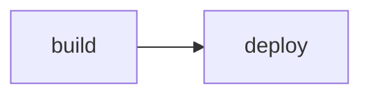

# Release checklist

[TOC]

## Scope

This release fixes <span data-issue-key="AXM-7" class="issue-ref">AXM-7</span> and adds a **new** board view. Ping <span class="mention">@Tim Schipper</span> with questions.

> [!WARNING]
> Run the migration before deploying.

:::issue AXM-12:::

## Steps

1. Build the image
2. Run `npx prisma migrate deploy`
3. Restart the API

- [ ] Tag the release

- [x] Update the changelog

| Service | Port |
| --- | --- |
| api | 3000 |
| web | 7000 |

```bash
npm run docker:dev
```



> [!DETAILS] Rollback
> Restore the previous image tag.

---

<details><summary>Raw HTML</summary>kept verbatim</details>

